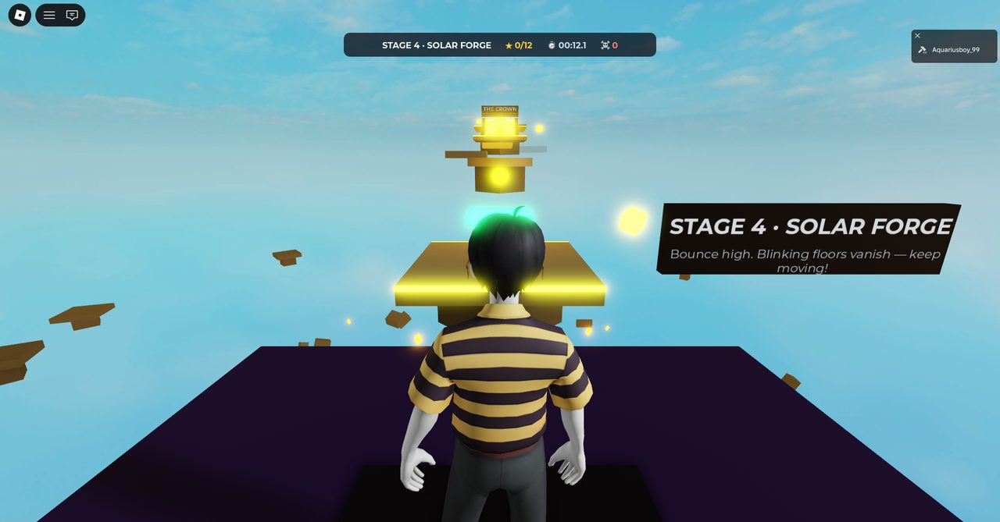

# Starfall Sprint

A four-stage sky obby for Roblox, built with Rojo and written in Luau.
Climb from the spawn plaza to the gold crown through **Ember Rise**,
**Frostbite Run**, **Void Crown** and the **Solar Forge** — 12 stars to
collect, 10 checkpoints, and 11 kinds of obstacles: movers, spinning
sweepers, timed gates, lava, near-frictionless ice, bounce pads, blinking
platforms, crumbling floors, glass discs, patrolling sentinel drones and
the crown's own guardian sweepers.

**Play it:** https://www.roblox.com/games/87164610878531

## Architecture

- `src/shared/Config.luau` — the whole course as data: stages, platforms,
  hazards, checkpoints, stars, gates and sentinels. If it is not in Config,
  it is not in the world.
- `src/shared/Format.luau` — time and rank formatting (Starfall Legend at
  150 s with all 12 stars, down to Crown Finisher).
- `src/server/WorldBuilder.luau` — builds the world from Config and returns
  a registry; owns no game state.
- `src/server/GameService.luau` — the sole state owner: checkpoints, stars,
  timers, stage splits, deaths, win detection, remotes.
- `src/server/Movers.luau` — one Heartbeat loop for every moving part,
  including blink and crumble state machines and rider carry that only
  carries grounded riders (so it can never eat a jump).
- `src/client/` — HUD with checkpoint progress bar, start/win screens with
  stage splits and session best, effects, sound and UI helpers.

## Building

With [Rojo](https://rojo.space) 7.x: `rojo build -o game.rbxl` (the built
place file is also committed). Lint with selene (`roblox.yml` +
`selene.toml` in the repo root), format with StyLua.

Entered in make.fun's "Make the best Roblox game": development-phase win
rate 961,832 (13W–4D–3L), provisional top 10 of 66, inside the prize zone.
